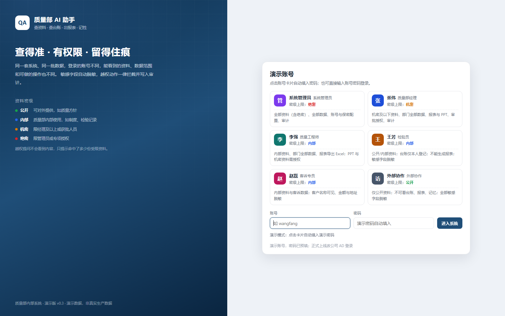
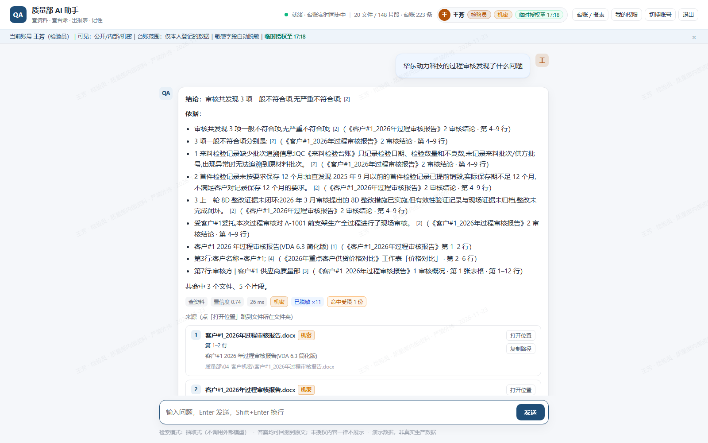

# 质量部 AI 助手

企业知识库问答系统：把共享盘里的制度文档与 Excel 台账在本地建索引，用自然语言提问，由大模型组织答案，
每条结论都能回到「文件 + 章节 / 工作表行 / 页码」。

> 本仓库只放设计说明与运行截图，**不含源码**。完整工程在私有仓库，面试或技术交流时可以临时授权查看。

## 它解决什么

| 痛点 | 做法 |
|---|---|
| 文件散在共享盘，搜不到 | 7 类解析器 + SQLite FTS5 中文全文检索，答完给出处定位 |
| 台账靠人汇总，口径对不上 | 成员本机保存即同步到公共盘，合并引擎写主档，冲突提示 + 版本回滚 |
| 数据不敢交给 AI | 上云前强制实体脱敏 + 出网闸限块数限字数；越权拦截、临时授权、全程审计 |

## 界面

**越权被拦。** 检验员问客户审核报告，不返回正文，只提示命中几份受限资料，给申请入口。

**授权后仍然脱敏。** 经理批 30 分钟临时授权，能看到审核结论，客户名和人名依旧是「客户#1」「人员#1」。

**六角色权限矩阵。** 管理员、经理、工程师、检验员、客诉专员、外部访客，14 项功能逐项给出可见性。

## 技术要点

- **检索与生成分离**：检索全在本地（FTS5 + BM25 + 覆盖率重排），大模型只把命中的片段组织成中文答案，
  来源由检索层给出。模型不参与「找资料」，所以答案可回溯、可审计，模型能随手换掉。
- **三种模式 + 自动降级**：没配 Key、断网、模型报错都回退到本地抽取式，不会答到一半崩掉。
- **7 类解析器**：docx / xlsx / pptx / pdf / txt / md / csv，统一切成带定位的片段。
- **台账合并按「一份文件 = 一个来源」整源覆盖**，不做整表追加，从机制上避免重复行。
- **报表数字确定性计算**：时间/维度/指标解析后走固定聚合，Cpk、帕累托、趋势不靠模型编。
- **权限四层**：文件级四级密级、字段级实体脱敏（客户#1 前后编号一致）、数据级范围隔离
  （本人 / 客诉 / 全部门 / 无）、行为级审计 + 水印。
- **出网闸**：总字数、块数、单块字数三重上限；图纸与模型类只发文件名，不发正文。

## 大模型接入

生产环境接的是云端大模型，走 OpenAI 兼容接口。仓库不含 Key，演示默认走本地抽取式，不联网也能跑完整流程。

| 服务 | base_url | 模型 | temperature |
|---|---|---|---|
| DeepSeek | `https://api.deepseek.com` | `deepseek-flash` | 0.1 |
| Kimi（国际） | `https://api.moonshot.ai/v1` | `kimi-k3` | 不传或 1 |
| Kimi（国内） | `https://api.moonshot.cn/v1` | `kimi-k3` | 不传或 1 |

> Kimi 的 `kimi-k3` / `kimi-k2.x` 是思考模型，只接受 `temperature: 1`，传 0.1 会直接 400；
> 所以实现里温度做成可配、可省略，交给服务端默认值。DeepSeek 没有这个限制。

以上为接入参考配置，未随仓库提供 Key。上云前两道闸：

1. **实体脱敏**：客户、供应商、人名、金额、地址、料号编号换成占位符，模型返回后本地还原；
2. **出网闸**：总字数 3000 / 块数 6 / 单块 500 字三重上限，图纸只发文件名。

## 工程规模

- 130 项自动化测试（检索、台账合并、报表、脱敏、出网闸、权限、审计、MCP）
- 演示数据：20 个文件 / 148 个片段 / 6 个来源 / 747 条台账
- 单机部署，Python 3.10+，无数据库服务依赖，索引与台账落在 SQLite

## 说明

- 截图与演示数据全部虚构：公司名、人名、电话、价格、配方均为样例，不对应真实业务。
- **不是开源项目**：保留所有权利，仅供浏览与评估；未经许可不得使用、复制、修改或分发，见 [LICENSE](LICENSE)。
- 需要看源码或现场演示，可通过 GitHub 账号联系。
