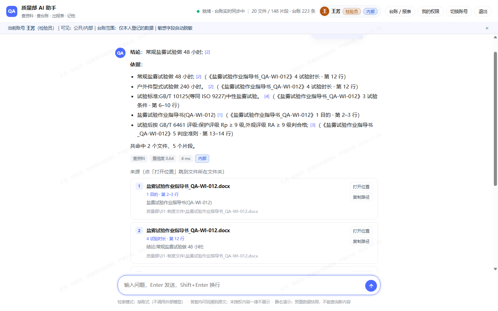
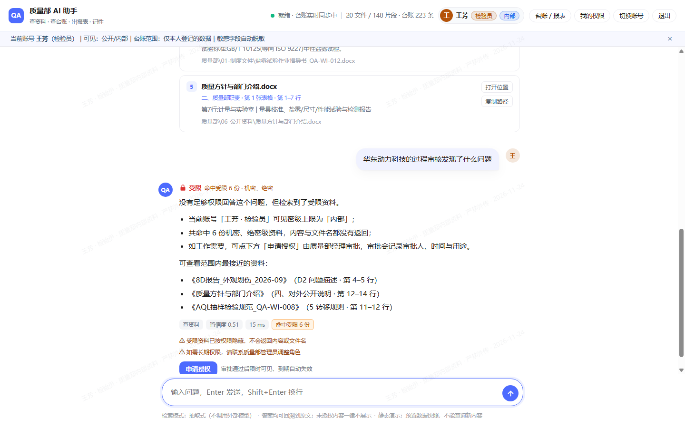
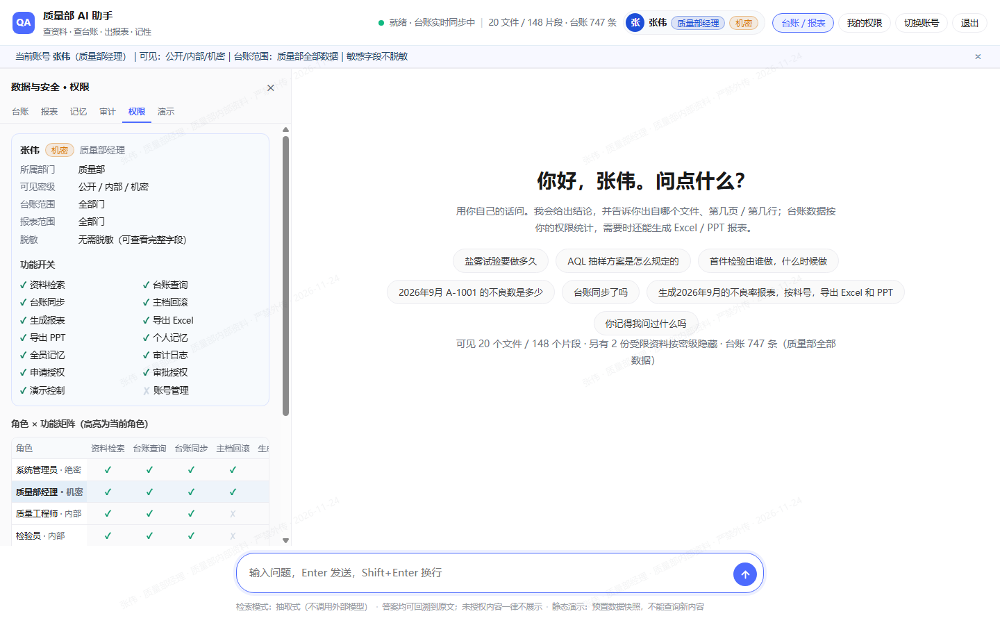

# 质量部 AI 助手

把企业共享盘里的制度文档和 Excel 台账建成本地索引，用中文提问，答案回到「文件 + 章节 / 工作表行」。
带四级密级、字段脱敏、数据范围隔离、临时授权与审计水印。

> **在线演示**：<https://ras788997-ship-it.github.io/quality-agent-demo/>
> 静态页，用录好的数据跑前端，可以登录、提问、看越权拦截；内置 13 个示例问题。
>
> 本仓库只有说明、截图和静态演示，不含后端源码。完整工程在私有仓库，面试可临时授权查看。

## 界面

**问答带出处。** 答完给出文件、章节和行号，来源卡片能定位到原件。

**越权被拦。** 检验员问客户审核报告，不返回正文，只提示命中几份受限资料。

**六角色权限矩阵。** 六个角色 × 14 项功能，逐项给出可见性。

## 做了什么

- **检索**：7 类解析器 + SQLite FTS5 中文全文检索，答案带出处定位
- **台账**：成员本机保存即同步，合并引擎写主档，冲突提示 + 版本回滚
- **报表**：自然语言出 Excel / PPT，Cpk、帕累托走确定性计算，不靠模型编
- **权限**：文件级四级密级、字段级脱敏、数据范围隔离、审计与水印
- **大模型**：检索在本地，答案可交给云端模型组织（OpenAI 兼容，如 DeepSeek / Kimi）；
  上云前强制脱敏 + 出网闸。不带 Key 时回退本地抽取式，演示不依赖模型

## 说明

- 截图与演示数据全部虚构，不对应真实业务
- **不是开源项目**：保留所有权利，仅供浏览与评估，见 [LICENSE](LICENSE)
- 需要看源码或现场演示，可通过 GitHub 联系
